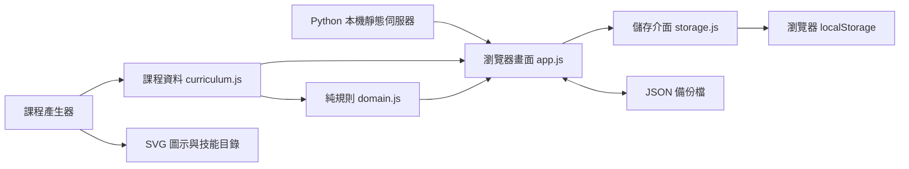

# 系統架構

## 技術選擇

使用 HTML、CSS 與原生 JavaScript 模組，無前端建置步驟與第三方執行期依賴。Python 標準函式庫只負責將 `app/` 提供為本機靜態網站，不接收進度，不提供資料庫服務。只綁定 `127.0.0.1`，埠號預設 4173。

0.2 起，一般使用者改用 Electron 桌面包，內含執行環境；上述 Python 入口保留作開發與備用。桌面版透過標準且安全的 `skill-talents://app` 來源提供相同前端，不啟動 HTTP 伺服器，也不要求使用者安裝 Python。打包使用開發依賴，產物不包含原始碼儲存庫、開發測試或 node_modules。



## 檔案職責

| 路徑 | 職責 |
| --- | --- |
| `start.py` | 本機 HTTP 與自動開啟瀏覽器 |
| `開啟天賦樹.command` | macOS 雙擊啟動入口 |
| `app/index.html` | 頁面結構、區域與無障礙標籤 |
| `app/styles.css` | 奇幻視覺、樹節點、響應式樣式 |
| `app/help.html` | 從兒童版 Markdown 產生的離線操作說明 |
| `desktop/main.cjs` | Electron 生命週期、視窗、選單與固定儲存位置 |
| `desktop/protocol.cjs` | 內部資源來源、MIME、路徑與導覽限制 |
| `electron-builder.cjs` | Windows x64 與 Mac Intel 打包設定 |
| `app/js/domain.js` | 加退點、先備、相依圖驗證、進度統計 |
| `app/js/storage.js` | 格式驗證、讀寫與備份封裝 |
| `app/js/progress.js` | 統一儲存結果與提示、辨識跨分頁儲存事件 |
| `app/js/app.js` | 事件處理、樹與清單、詳情、對話框 |
| `app/data/curriculum.js` | 由產生器輸出的課程資料 |
| `app/assets/icons/` | 原創 SVG 圖示 |
| `scripts/build_curriculum.py` | 課程編輯來源與產生器 |
| `scripts/build-help.mjs` | 將操作說明產生為獨立 HTML |
| `scripts/package-desktop.mjs` | 建置 ZIP 與 SHA-256 清單，不自動上傳 |
| `scripts/write-checksums.mjs` | 只為目前版本與本次指定平台產生校驗清單 |
| `scripts/verify-desktop.mjs` | 每次打包後檢查實際 ASAR 內的資源與來源一致 |
| `scripts/zip-utf8.mjs` | 依實際 UTF-8 檔名補齊 ZIP 編碼標記，保留原壓縮資料 |
| `tests/domain.test.js` | 不依賴瀏覽器的核心測試 |
| `tests/progress.test.js` | 儲存失敗提示、清除事件與延遲事件回歸測試 |
| `tests/desktop.test.js` | 桌面資源、入口設定、離線說明與視窗限制測試 |
| `tests/package.test.js` | 真實 ASAR 產生與缺少說明檔的回歸測試 |
| `tests/checksums.test.js` | 校驗清單排除舊版本與其他平台，缺少產物時保留原清單 |
| `tests/zip.test.js` | 中文 ZIP 標記、重跑一致性與無效資料拒絕測試 |
| `docs/` | 繁體中文計畫、架構、課程與驗證 |

## 課程資料模型

職業含 `id`、`name`、`target`、`schemaVersion`、`curriculumVersion`、分支及技能。技能包含：

```json
{
  "id": "f01",
  "branch": "foundation",
  "lane": 0,
  "level": 0,
  "title": "初始字母之印",
  "topic": "26 個大寫字母",
  "hours": 8,
  "description": "辨認 A–Z、逐字母唸名稱，練習筆順與抄寫。",
  "checkpoint": "不看範本寫出並唸出 26 個大寫字母。",
  "prerequisites": [],
  "icon": "assets/icons/f01.svg"
}
```

`lane`、`level` 僅控制地圖位置，不決定相依關係。`prerequisites` 才是真正的解鎖條件；可為空、跨分支或包含多項，全部採 AND。相依圖需為有向無環圖，不以「上一排」或「同路線前一個」作隱含鎖定。

## 加退點規則

- 投入僅允許 `+1`：先備全部滿點、目前點數小於 `hours` 才成功。
- 收回僅允許 `-1`：目前大於零，且所有直接後續技能皆為零才成功。
- 合法狀態下只檢查直接後續已足夠，因為更遠後續的先備鏈也必須保持完整。
- 退點不級聯清除。使用者從後往前退點；重置則整套歸零。
- 所有點數為整數，範圍 0–20，實際上限依節點 `hours`。
- 規則層回傳新物件，不原地修改既有狀態；錯誤操作不改進度。
- 啟動驗證重複 ID、遺失先備、超過 20 小時及循環相依。

## 進度與儲存

儲存鍵：`skill-talents:Eng-TOEIC:v1`。只儲存非零點數，不儲存題目答案、個資或雲端資訊。

```json
{
  "schemaVersion": 1,
  "curriculumVersion": "2026.10.1",
  "classId": "Eng-TOEIC",
  "updatedAt": "2026-10-17T08:00:00.000Z",
  "points": { "f01": 8, "f02": 3 }
}
```

每次成功加退點、匯入或重置後立即儲存。重開時讀取並驗證整份狀態。相同來源其他分頁的變更以 `storage` 事件同步；採最後一次成功寫入為準，並非交易式多視窗資料庫。若本分頁有儲存錯誤，不靜默套用其他分頁資料，以免遺失未匯出的進度。建議只使用一個分頁記點。

同步包含單一鍵移除及 `localStorage.clear()`，並排除 `sessionStorage` 與無關鍵的事件。收到事件後重新讀取當前儲存值，避免延遲事件的舊資料取代較新的進度。

localStorage 僅屬於同一瀏覽器、同一來源（協定、主機與連接埠）。`localhost` 與 `127.0.0.1` 不共用儲存；換埠、換瀏覽器或清除資料也不能直接續接。JSON 才是跨裝置備份方式。

桌面版使用固定 `userData`：Windows 的 `%APPDATA%\SkillTalents`、Mac 的 `~/Library/Application Support/SkillTalents`。固定內部來源讓移動程式與更新時繼續使用同一份 localStorage，與舊瀏覽器資料分開；備份封裝不變，可手動匯出匯入搬移。

桌面視窗維持 `nodeIntegration: false`、`contextIsolation: true`、`sandbox: true`，不透過 preload 暴露系統 API。資源處理器只讀取 `app/` 內允許類型的檔案；拒絕任意外部導覽、新視窗和權限要求，操作說明是明確允許的獨立視窗。CSP 不允許外部連線與遠端程式碼。

## 匯入與錯誤復原

1. 匯入上限 100 KB；先解析 JSON，再檢查結構版本、職業、課程版本。
2. 驗證所有 ID、整數範圍及每個已投入技能的先備完整性。
3. 驗證成功才顯示摘要與確認；取消不修改現況。
4. 版本不符先拒絕，保留原檔，不猜測或靜默丟棄技能。
5. 本機原檔損毀時保留原始字串並暫停加退點，提供原始資料下載，使用者可匯入有效備份或確認重置。
6. 儲存失敗時保留這次記憶體進度，明確顯示警告並提供匯出，不顯示儲存成功。

加退點、滿點、匯入與重置都透過同一個儲存結果決定提示；只有實際寫入成功才顯示完成訊息，失敗提示不被後續的成功文案蓋掉。

初版無版本遷移機制；改動技能 ID、時數或先備前需提高課程版本，設計可回滾的遷移並先備份。發布更新不能假設舊進度仍符合新先備。

## 新增職業的後續架構

目前介面載入單一課程；選單中的日語與素描只是規劃提示，不是假裝可用的職業。擴充時：

1. 各職業建立獨立資料模組，保留通用欄位與 20 小時上限。
2. 新增職業登錄表，再由選擇結果建立 engine 與 persistence。
3. 儲存鍵改由職業 ID 與結構版本產生；切換前確認當前記憶體狀態已保存。
4. 每職業分別匯出及重置，禁止清除其他職業進度。
5. 寫入各職業資料完整性與可達性測試。

日語不依賴 Eng-TOEIC；素描也不因英語進度被鎖。若不同英語職業未來想承認共通能力，需另設明確的先修認列與診斷規則，不直接共用可變點數。

## 維護與部署

修改課程後執行 `python3 scripts/build_curriculum.py`，產出資料、全部 SVG 和技能目錄，再執行 `node --test`。一般 UI 修改不需重建，重新整理即可。

桌面版變更需重新打包；操作說明由 `docs/操作說明.md` 產生，每次打包前自動更新。維護者使用 Node.js 與 pnpm，完整指令、最低系統版本、未簽章限制與進度移轉方式見[桌面版與打包](桌面版與打包.md)。

可將 `app/` 原樣放到靜態主機，無需後端；本次依使用者需求只提供本機版，不發布。更換託管網址不會搬移 localStorage，需先匯出再匯入。
